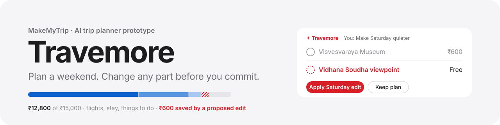
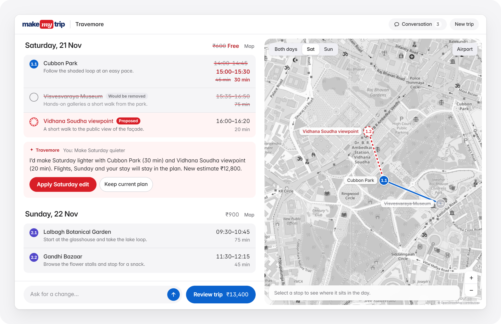
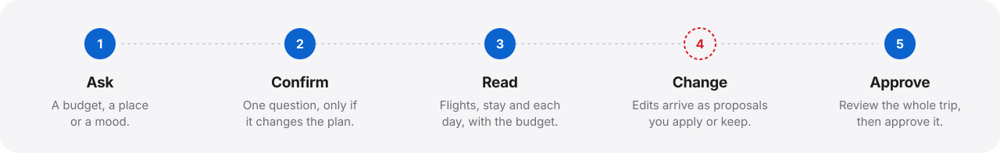
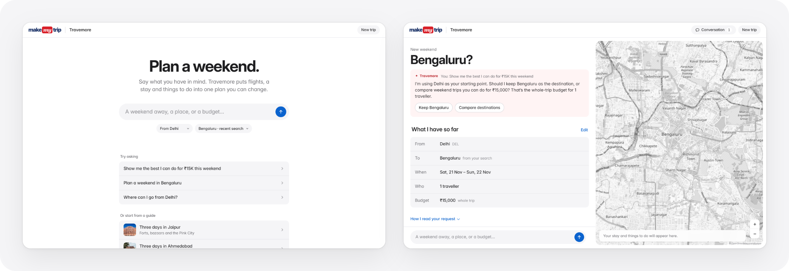
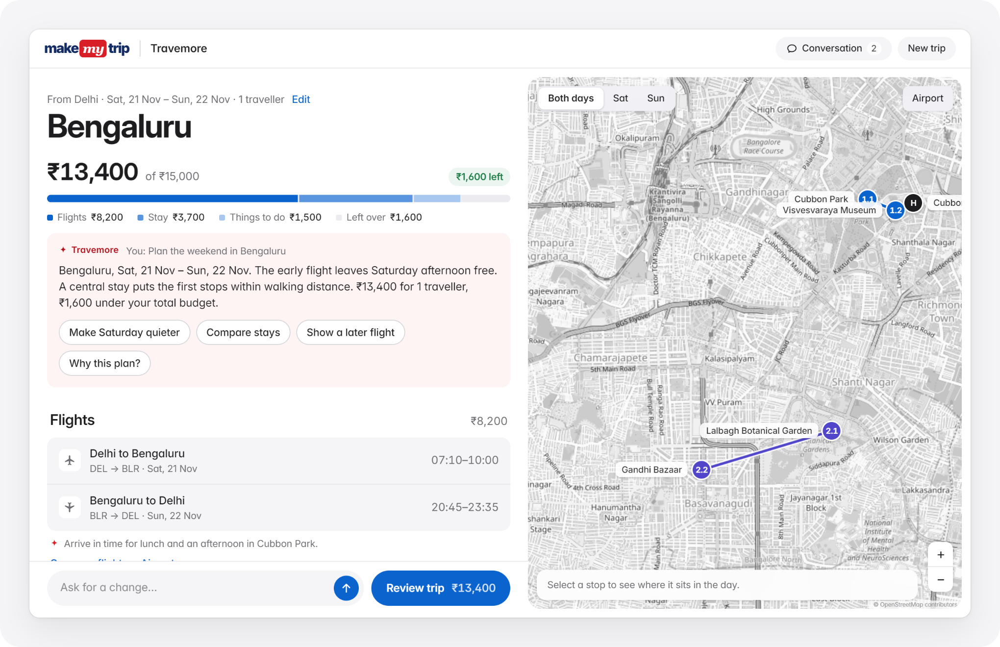
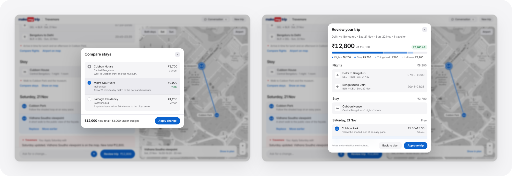
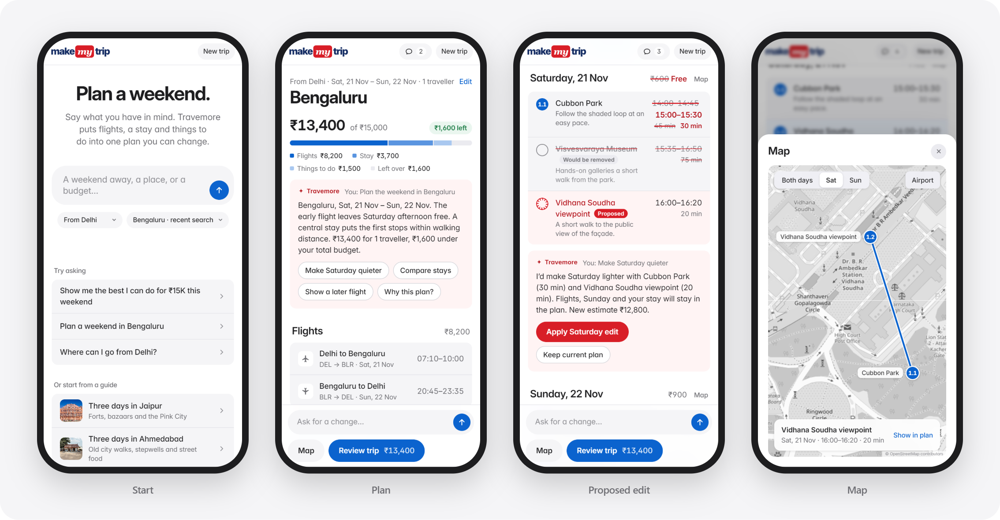
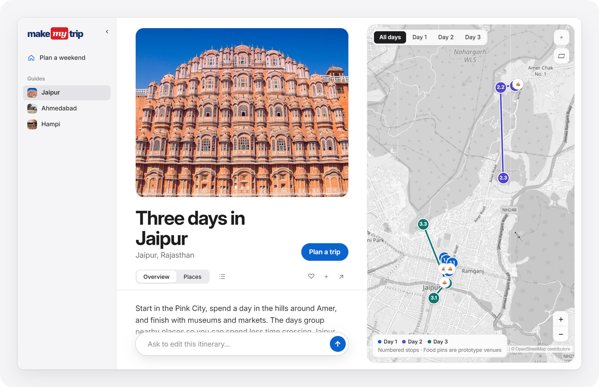
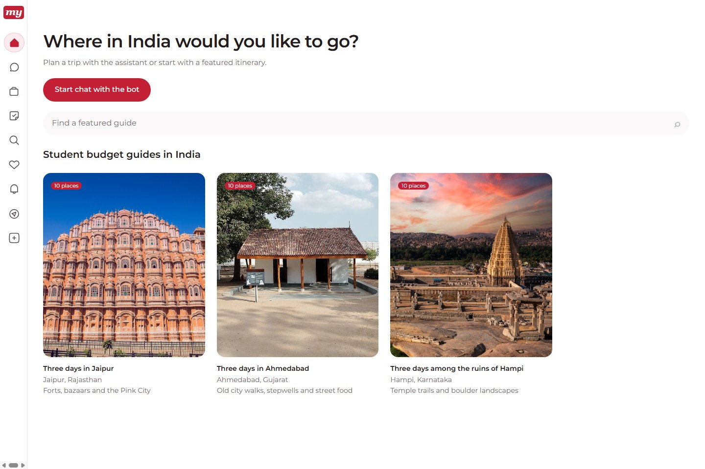

<picture>
  <source media="(prefers-color-scheme: dark)" srcset="screenshots/redesign/header-dark.svg">
  
</picture>

<br>

**A weekend trip you can ask for, see on a map, and change before you commit.**

Travemore is an AI trip planner prototype for MakeMyTrip, made for the Razorpay Design × NID campus hiring exercise. It is designed for one traveller from the brief: someone with a weekend, ₹15,000 and no fixed destination.

[How it works](#how-it-works) · [Design principles](#design-principles) · [Research](#research) · [How it got here](#how-it-got-here) · [Run it](#run-it)

<br>



<br>

## How it works

<picture>
  <source media="(prefers-color-scheme: dark)" srcset="screenshots/redesign/flow-dark.svg">
  
</picture>

### 1 · Ask, then confirm only what matters

Type a request in your own words, or pick one of three examples. Travemore fills in what it can from the search context: you are leaving from Delhi and you recently searched for Bengaluru. It asks one question only when the answer changes the plan: keep Bengaluru, or compare destinations.



### 2 · Read the plan as one page

Flights, the stay and each day sit in grouped lists, with the map beside them. A budget bar under the total shows where the ₹15,000 goes: flights, stay, things to do, and what is left. Each reason the assistant gives sits next to the part of the plan it explains, such as why the early flight or why this stay.



### 3 · Change one part without starting over

Ask for "Make Saturday quieter". The assistant answers with a proposal, not a finished change. The stop it would remove is struck through, the new stop is marked **Proposed**, and the map draws the new route as a dashed red line. The total shows the saving before anything changes. **Apply** commits the edit and **Undo** reverses it.

Stays and flights work the same way. **Compare stays** lists each option with its price difference. Choosing one shows the new total before you apply it.

### 4 · Review and approve

The review sheet shows the whole trip, the budget bar and the price of each part. Approval stays disabled while the trip is over budget or a stay is unavailable.



### On a phone

The plan becomes a single column. The composer and **Review trip** stay pinned to the bottom, and the map opens as a sheet.



### Or start from a guide

The start screen also links to three ready-made guides: Jaipur, Ahmedabad and Hampi. Each guide pairs a day-by-day itinerary with a map that can be filtered by day.



## Design principles

| | |
| --- | --- |
| **The assistant writes next to what it means.** | There is no chat column. Each reply appears beside the flight, stay or day it is about. The full conversation is one tap away in **Conversation**. |
| **A change is a proposal until you apply it.** | Edits show as tracked changes on the plan, the map and the total, with **Apply** and **Keep current plan** side by side. |
| **The budget is always one glance away.** | One bar shows how much of the budget each part takes. A pending saving is drawn as a hatched section of the bar. |
| **Red belongs to the assistant.** | Blue is for things you do. MakeMyTrip red marks only the assistant's notes, its proposals and the button that applies them. |
| **One typeface, plenty of room.** | The system font (SF on Apple devices, Inter elsewhere), system greys, grouped lists and sheets. MakeMyTrip's header and wordmark stay as they are. |

## Research

Three people gave feedback after using an earlier version of the prototype. What they said shaped three decisions that carry into this design.

| What they valued | How the design responds |
| --- | --- |
| **Choosing when to use the assistant.** The bot was available when they wanted it, not constantly in their face. | You can type a request or open a guide directly. Replies sit beside the plan instead of taking over the screen. |
| **A few relevant questions.** A short set of familiar questions was enough for the plan to feel personal. | The assistant uses what you already gave it and asks only about an ambiguous destination. Dates, travellers and budget are edits, not a questionnaire. |
| **A practical sense of the day.** Seeing places, route order and nearby food helped them judge whether a plan would work. | The map stays beside the plan, filtered by day. A proposed edit is drawn on the map before you apply it. |

<details>
<summary>Read what participants said</summary>

> I really liked having the freedom to choose between talking to the bot or planning the trip on my own. The bot wasn't constantly in my face. Instead, it felt like an option I could turn to whenever I needed help, which made the whole experience feel much more comfortable and flexible.

> The questions didn't feel overwhelming or like too much of a task. They were simple, relevant questions that I would naturally consider while planning a trip anyway. What I found really impressive was how just a few questions could generate an entire itinerary, covering everything from travel and accommodation to food and places to visit. I also liked how customisable everything was, especially when it came to my personal preferences and budget restrictions. It felt like the itinerary was actually made for me rather than being a generic travel plan.

> One of my favourite features was definitely the map. It helped me actually visualise what a day of the trip would look like, rather than just reading through a list of places. I could see where everything was located, how far I would have to travel, and what food options were available along the way. This made it much easier to understand how the day would flow and whether the plan was actually practical, while also giving me a better sense of the place before even getting there.

</details>

The feedback was gathered on Iterations 1 and 2. The redesign described above has not been tested with users yet.

## How it got here

**Iteration 1 · A standalone planner.** A choice on arrival: chat with the bot, or open a featured guide for Jaipur, Ahmedabad or Hampi and explore its day map at your own pace. An early details form made the start feel heavy, so the questions moved into the conversation.

**Iteration 2 · Inside MakeMyTrip.** The same idea in a familiar booking environment: a command bar with example requests, an editable search context, and an itinerary beside its map. A three-column layout with a permanent chat panel squeezed the plan and the map, so it was dropped.

**Iteration 3 · A minimal redesign.** Iteration 2 worked but looked generic. Three visual directions were built as clickable mockups: one themed on Indian road signs, one built around the budget, and one editorial, with the assistant's notes written in the margin. The editorial direction's interaction model was kept: replies sit next to what they are about, and edits arrive as tracked changes. Its serif styling was dropped for a quieter, Apple-like system that sits more naturally inside MakeMyTrip. The budget-led direction contributed the budget bar.

<details>
<summary>See Iterations 1 and 2</summary>

| Iteration 1 · Standalone planner | Iteration 2 · MakeMyTrip planner |
| --- | --- |
|  |  |
| [Open the live Iteration 1 ↗](https://lingering-cake-15d2.ankityadavmegamind2005.workers.dev/inspiration/) | [Open the live Iteration 2 ↗](https://snowy-field-9745.ankityadavmegamind2005.workers.dev/) |

The live links show Iterations 1 and 2. The redesign is not deployed yet; [run it locally](#run-it) to try it.

</details>

### How AI informed the work

- **Framing.** AI helped explore what a loose request like "the best I can do for ₹15K" could mean, and which questions would actually change the plan. That separated a stated constraint (the budget) from a clue (a recent search), which is why the destination is confirmed explicitly.
- **Building.** AI turned layout and interaction ideas into working states quickly. That made it easy to see when the assistant was taking too much space, which led to rejecting the permanent chat column.
- **Redesign.** AI produced three visual directions as working pages to compare side by side, then rebuilt the planner and guides in the chosen system. The choice of direction, and what to keep from each one, was made by people.
- **In the product.** The assistant collects intent, clarifies an ambiguous destination, and proposes a whole plan or a scoped edit. Replies, prices and availability are simulated so the demo can be reviewed without a model key or a real booking.

### What to test next

- Give people a fixed budget and no destination. Do they understand why Bengaluru appeared, and do they feel free to pick another city?
- Ask someone to lighten a day and someone else to replace a stay. Do they read the proposal on the plan and the map before applying it, and can they undo it?
- Check whether the budget bar is read correctly at a glance, especially the hatched saving from a pending edit.
- On a phone, ask someone to find a stop on the map and return to it in the plan without losing the selected day.

## Run it

Use **Node.js 22.19 or later**, npm and Git. From the repository root:

```sh
npm ci
npm run dev --workspace client
```

Open the URL Vite prints, then visit `/inspiration` for the planner or `/inspiration/jaipur` for a guide. The planner runs entirely in the browser with fixed demo data, so it needs no API key. Map tiles need an internet connection.

<details>
<summary>Build, deploy and source map</summary>

### Build and verify

```sh
npm run build --workspace client
npm run typecheck
npm run cloudflare:build --workspace client
```

### Deploy

To deploy to Cloudflare Workers, sign in with `cf` and run `npm run cloudflare:deploy` from `client/`. The Worker serves the app, its routes and the optional guide APIs. The ZIPs in [`releases/`](releases) are the earlier Iteration 1 and 2 builds, not this redesign. If you use the guide integrations, add `CARTO_BASEMAPS_API_KEY` and `GROQ_API_KEY` as Cloudflare secrets, or pass a private `client/.dev.vars` with `npm run cloudflare:deploy -- --secrets-file .dev.vars`. Without a CARTO key, the map falls back to OpenStreetMap tiles.

### Where things are

| Area | Files | What they do |
| --- | --- | --- |
| Design tokens | [`tokens.css`](client/src/tokens.css) | Typeface, greys, the blue accent, the assistant's red and the budget bar colours, shared by every page. |
| Planner | [`Travemore.tiny.js`](client/src/components/Travemore.tiny.js), [`travemore.css`](client/src/travemore.css) | Composer, clarification, the plan, notes beside each section, tracked edits, sheets and review. |
| Trip data | [`travemoreTrip.js`](client/src/travemoreTrip.js) | Demo flights, stays and stops, and the schedule, totals and map points derived from them. |
| Maps | [`travemoreMap.js`](client/src/travemoreMap.js), [`itineraryRoutes.js`](client/src/itineraryRoutes.js) | Leaflet pins and routes, day colours, and proposed or removed stops. |
| Guides | [`IndiaInspiration.tiny.js`](client/src/components/IndiaInspiration.tiny.js), [`guides.css`](client/src/guides.css), [`indiaGuides.js`](client/src/indiaGuides.js) | The Jaipur, Ahmedabad and Hampi guides with their day maps. |
| Hosting | [`worker.ts`](client/worker.ts), [`cloudflare.config.ts`](client/cloudflare.config.ts) | Serve the app and the optional guide APIs on Cloudflare Workers. |

The client uses **TinyBubble**, **Vite** and **Leaflet**. The `server` workspace holds the upstream TravelMore server and the optional guide integrations; see [UPSTREAM.md](UPSTREAM.md).

</details>

<br>

<sub>The demo covers weekend trips from Delhi or Mumbai to Bengaluru or Jaipur, using sample inventory, prices and reviews. Approval is simulated and nothing is booked. Maps © OpenStreetMap contributors. Photos: [Vidhana Soudha](https://commons.wikimedia.org/wiki/File:Vidhana_Soudha_in_daylight.jpg) and [guide photo credits](client/public/asset-credits.txt). Fonts are under the SIL Open Font License. Code under the [MIT License](LICENSE).</sub>
