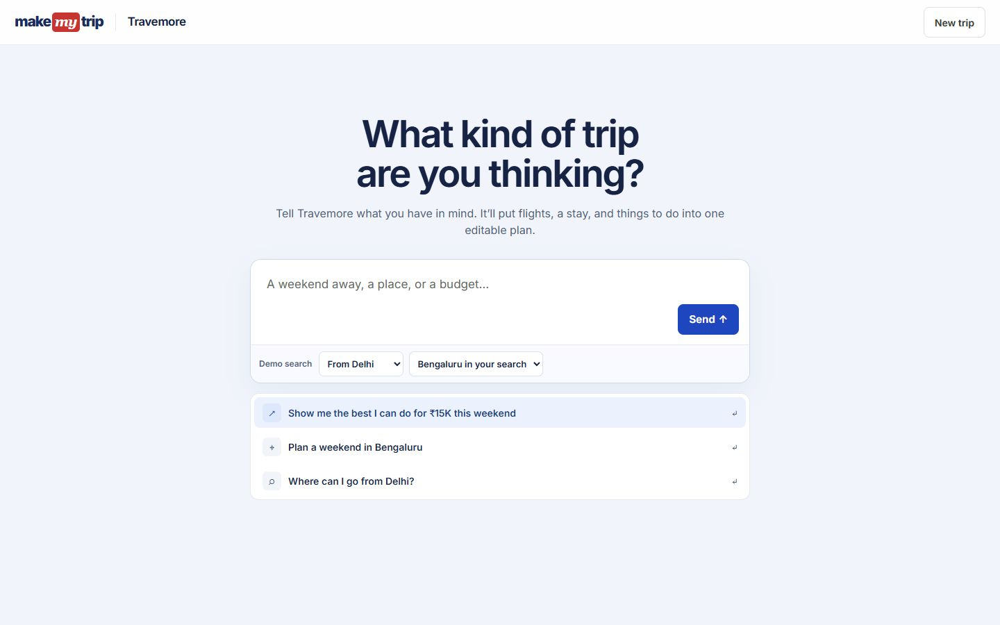
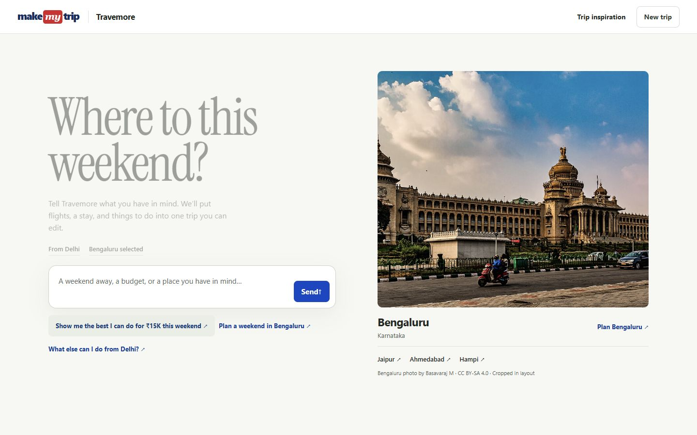
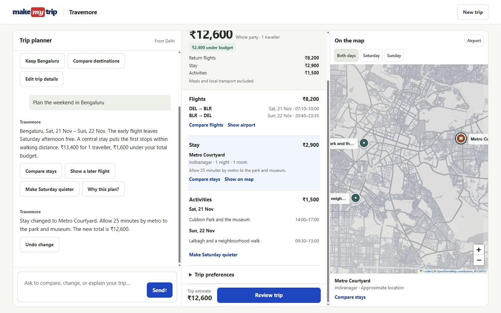
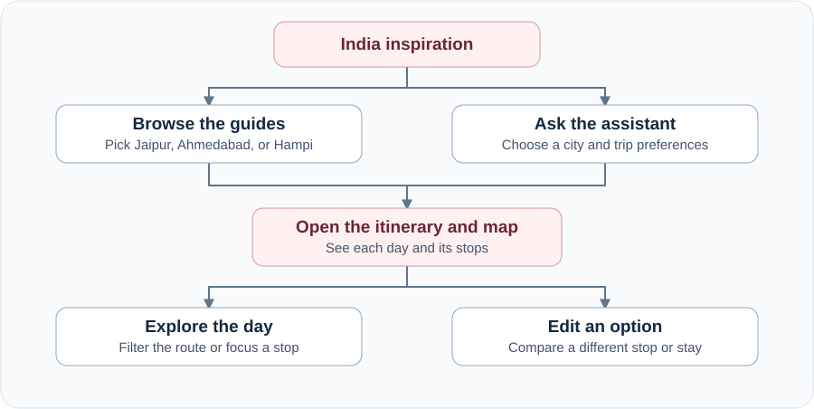
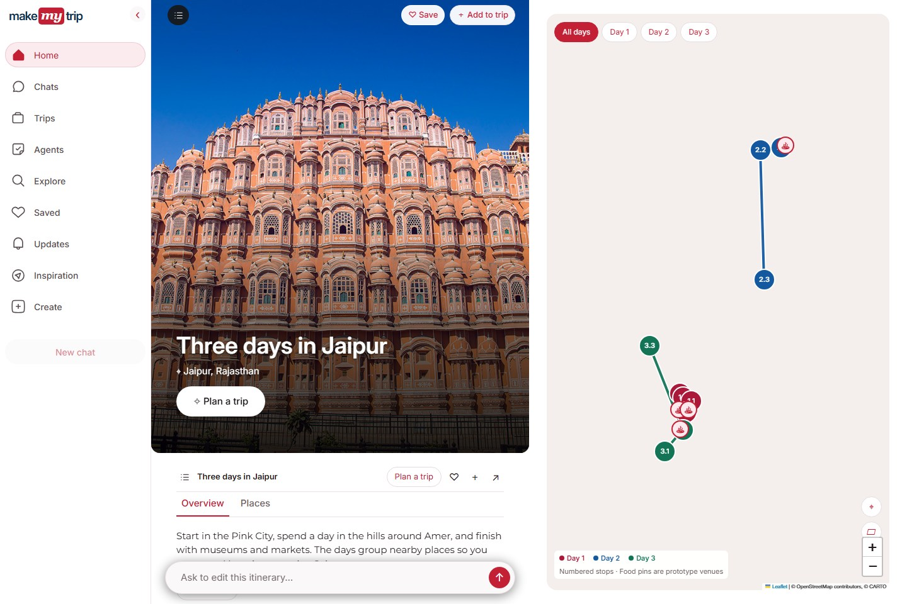
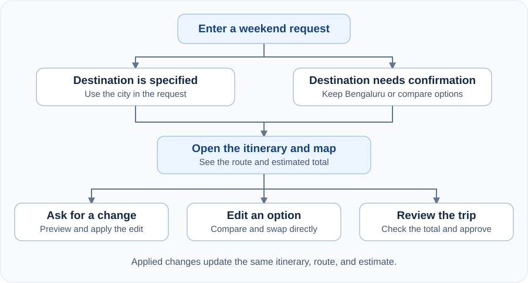
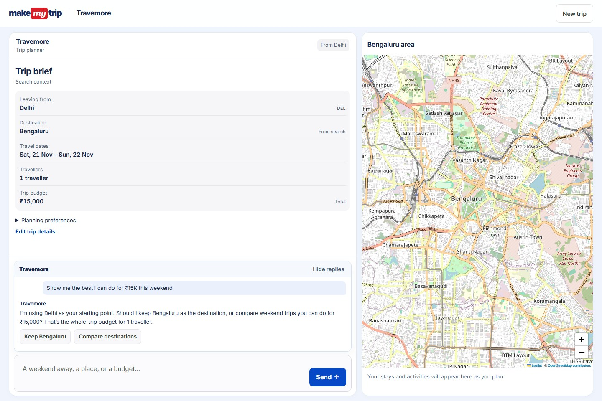
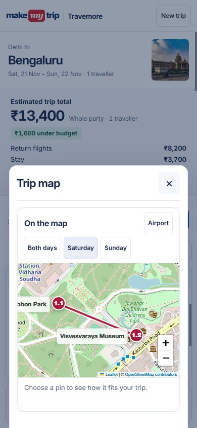
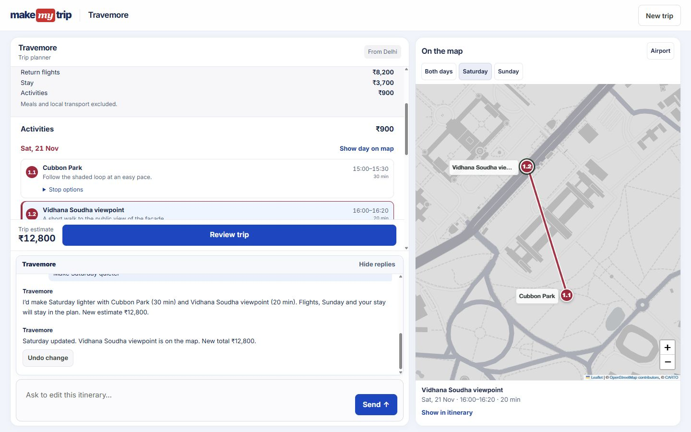
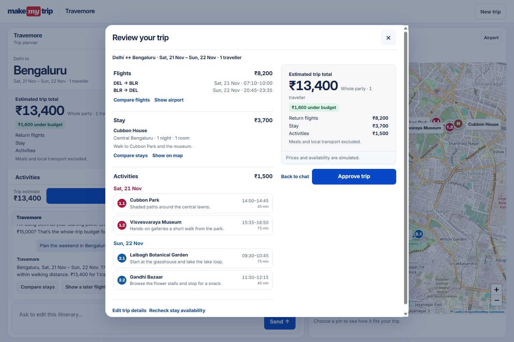

# AI Trip Planner

**A weekend trip you can ask for, see on a map, and change before you commit.**

A MakeMyTrip web prototype for the Razorpay Design × NID campus hiring exercise. The project follows a traveller who has a weekend and ₹15,000 to spend, but is still deciding where to go.

[Live prototypes](#live-prototypes) · [Research](#research) · [Design process](#design-process) · [Page flows](#page-flows) · [Final walkthrough](#final-walkthrough) · [Technical appendix](#technical-appendix)

## Live prototypes

| Iteration 1 · Standalone planner | Iteration 2 · MakeMyTrip planner |
| --- | --- |
| [](https://lingering-cake-15d2.ankityadavmegamind2005.workers.dev/inspiration/) | [](https://snowy-field-9745.ankityadavmegamind2005.workers.dev/) |
| [Open Iteration 1 on Cloudflare ↗](https://lingering-cake-15d2.ankityadavmegamind2005.workers.dev/inspiration/) | [Open Iteration 2 on Cloudflare ↗](https://snowy-field-9745.ankityadavmegamind2005.workers.dev/) |
| A simple, inviting planner. Start a conversation or open a featured guide and explore on your own. | The same planning principle inside MakeMyTrip. Start with a request, use search context, and review the editable trip. |

Both iterations give the traveller a way to plan with AI and inspect or change the itinerary themselves. The difference is the design context. Iteration 1 explores how approachable a standalone assistant can feel. Iteration 2 brings that same control into a familiar booking environment.

## The brief

The assignment asks for a conversational travel experience on an existing booking platform. The traveller should be able to express intent, get a multi-day plan spanning travel, accommodation and activities, and review or replace parts before approving it.

I chose the **Weekend Escaper** from the brief. This traveller is time-constrained and budget-conscious, with firmer dates than destination preferences. The initial interest in affordable student travel helped surface concrete options like dorms, shared transport and inexpensive meals. I kept affordability as a planning constraint and removed the assumption that everyone arriving at the landing page was a student.

The design question was **how much can the assistant put together for a traveller while leaving them in control of the pieces that matter?** A coherent shortlist needs to answer three things at once. What can I afford, does the day make sense on the ground, and can I change one part without having to rebuild everything?

## Research

Three pieces of qualitative feedback helped check the experience against those questions. The comments describe what people valued while using the prototype. They support the choices below and leave open questions for the next round.

| What the feedback highlighted | Design response |
| --- | --- |
| **Control over how to start.** The guide browsing route made planning feel approachable, and assistance was welcome when the traveller asked for it. | Keep guides available directly. In the weekend planner, open the assistant on the traveller’s action and put manual controls beside the trip. |
| **A small number of relevant questions.** A few familiar constraints were enough to make the result feel personally useful. | Capture what the traveller already supplied. If the destination is ambiguous, show the origin, budget and weekend alongside a single choice to keep the search destination or compare. Offer dates, traveller count and specific swaps as edits. |
| **A practical sense of the day.** Seeing places, route order and food nearby helped people judge whether the plan would work. | Pair the itinerary with a day-filtered map. Keep the route visible while exploring a stop or reviewing a suggested change. The first iteration’s guide map also exposes nearby budget food. |

### Participant feedback

**Choosing when to use the assistant**

> I really liked having the freedom to choose between talking to the bot or planning the trip on my own. The bot wasn't constantly in my face. Instead, it felt like an option I could turn to whenever I needed help, which made the whole experience feel much more comfortable and flexible.

**Personalisation without a long setup**

> The questions didn't feel overwhelming or like too much of a task. They were simple, relevant questions that I would naturally consider while planning a trip anyway. What I found really impressive was how just a few questions could generate an entire itinerary, covering everything from travel and accommodation to food and places to visit. I also liked how customisable everything was, especially when it came to my personal preferences and budget restrictions. It felt like the itinerary was actually made for me rather than being a generic travel plan.

**Understanding the trip on the map**

> One of my favourite features was definitely the map. It helped me actually visualise what a day of the trip would look like, rather than just reading through a list of places. I could see where everything was located, how far I would have to travel, and what food options were available along the way. This made it much easier to understand how the day would flow and whether the plan was actually practical, while also giving me a better sense of the place before even getting there.

## Design process

### Iteration 1 · Make AI planning approachable

The first design gives people a simple choice on arrival. **Start chat with the bot** opens a guided conversation. The featured Jaipur, Ahmedabad, and Hampi cards let travellers start with a concrete trip and explore at their own pace. Once inside a guide, they can filter the day map, see nearby budget food, and compare a different stop or stay.

I wanted the assistant to feel inviting and easy to try. The visible entry point signals what it can do, and the guide cards give people another way in. An early travel-library popup and an up-front details form made this entry feel heavier, so the guide-first design moved the questions into the conversation.

### Intermediate exploration · Lead with a destination

I tried a large Bengaluru photo and an editorial headline to establish a sense of place. The photo gave one unconfirmed destination too much visual weight. I kept destination imagery for the point where it helps a traveller evaluate an actual option.



### Iteration 2 · Bring the same principle into MakeMyTrip

The second design keeps the lightweight assistant and editable itinerary, then places them in a familiar MakeMyTrip environment. A focused command bar and three example requests make it easy to get started. **From Delhi** and **Bengaluru in your search** are editable. An ambiguous budget request carries into the conversation, where the traveller can keep Bengaluru or compare options.

A three-column experiment gave chat a permanent panel and squeezed the timetable and map. The MakeMyTrip design uses the same two-area relationship as the Jaipur guide. The assistant stays with the itinerary and the map sits beside it. On mobile, the map opens from the itinerary and can take the traveller back to a selected stop.

<details>
<summary>See the three-column exploration</summary>



</details>

### How AI informed the work

- **Discovery and framing.** I used AI to explore what a loose request could mean and which questions would change the plan. The ₹15K scenario exposed a useful distinction between a stated constraint and a clue from search history. I kept explicit destination confirmation and dropped the up-front questionnaire from the weekend path.
- **Exploration and building.** AI helped turn itinerary and map alternatives into working states. The early layouts made clear how easy it was to give the assistant too much screen space. I rejected the permanent chat column and tested the effect of an edit in the itinerary and on the route.
- **In the product.** The assistant collects intent, clarifies an ambiguous destination, and proposes a plan or a scoped edit. The traveller confirms the destination, can compare or replace individual choices, and sees what will change before applying it. Iteration 2 uses repeatable simulated replies and prices so the demo can be reviewed without a model key or actual booking.

## Page flows

### Iteration 1 · Start with chat or a guide





### Iteration 2 · Plan and review within MakeMyTrip



## Final walkthrough

### 1. Start with ₹15K

From the [weekend planner](https://snowy-field-9745.ankityadavmegamind2005.workers.dev/), select **Show me the best I can do for ₹15K this weekend**. The request moves into the conversation. The companion area shows the origin, weekend and budget while the destination is being decided. Choose **Keep Bengaluru** for the walkthrough, or **Compare destinations** to see the alternative path.



### 2. Understand the plan

The Bengaluru result is **₹13,400** under the seeded demo choices. The itinerary presents flights, a stay and activities in day order. Select a day to see its route, then select a stop in the itinerary or on the map to see where it sits in the day. Compare a stay or flight directly if the change is already clear. Map lines show the stop sequence and give the traveller a spatial preview. The review keeps meals and local transport outside the displayed trip estimate.

<details>
<summary>See the mobile map and day filters</summary>



</details>

### 3. Make Saturday quieter

Ask **Make Saturday quieter** in the itinerary composer. The assistant previews a shorter visit to Cubbon Park and a stop at the Vidhana Soudha viewpoint. Choose **Apply Saturday edit**. The affected stop **1.2** is highlighted, the connection changes on the map, and the estimate updates to **₹12,800**. The traveller can undo the edit.



### 4. Review before approving

**Review trip** groups the estimate by flights, stay and activities. The traveller can return to edit a selection before approving the demo plan. The prototype also shows an over-budget state with saving options, and an unavailable-stay scenario that lets the traveller pick a replacement while keeping the rest of the trip in view.



## What I would test next

- Give people a fixed budget and no destination. Watch for whether they understand why Bengaluru appeared and whether they feel comfortable choosing another city.
- Ask someone to replace a stay and someone else to lighten a day. Check whether they see the cost and route effects before applying, then check whether they can undo the change.
- On mobile, ask the traveller to identify a stop from the map and return to its itinerary row. Check whether they can do it while keeping track of their selected day.
- Test a group-budget scenario and a sold-out stay. The next prototype should make per-person versus total estimates easier to compare and show fuller route-time evidence before approval.

The prototype covers selected weekend trips from Delhi or Mumbai and uses sample inventory, prices and reviews. Approval is simulated. For photo attribution, see the [Bengaluru photo license](https://commons.wikimedia.org/wiki/File:Vidhana_Soudha_in_daylight.jpg) and [Ahmedabad photo credits](client/public/asset-credits.txt).

## Technical appendix

### Run locally

Use **Node.js 22.19 or later**, npm, and Git. From the repository root:

```sh
npm ci
npm run dev --workspace client
```

Open the URL printed by Vite and visit `/inspiration`. The demo uses browser-side fixtures and runs without an API key. Map tiles need internet access.

The optional guide APIs run in the server workspace. Start it with `PORT=4785` and `npm run dev --workspace server`. Point the client at the local server using the proxy setting in [Vite config](client/vite.config.js). The server can use `CARTO_BASEMAPS_API_KEY` for map tiles and `GROQ_API_KEY` for the existing guide’s optional planning flow. The main weekend demo uses deterministic replies.

### Source map

| Area | Where to look | What it does |
| --- | --- | --- |
| Planner | [Client components](client/src/components) | Runs the command bar, clarification, itinerary edits, comparison, and review. |
| Trip state and prices | [Client trip fixtures](client/src) | Holds weekend fixtures and derives the schedule, trip total, and map points from the same selections. |
| Maps | [Route drawing](client/src/itineraryRoutes.js) | Render Leaflet markers and day connections, share route drawing with the Jaipur guide, and sync selection with itinerary rows. |
| Original guides | [IndiaInspiration.tiny.js](client/src/components/IndiaInspiration.tiny.js) and [indiaGuides.js](client/src/indiaGuides.js) | Serve the existing Jaipur, Ahmedabad, and Hampi guides. |
| Hosting | [worker.ts](client/worker.ts) and [cloudflare.config.ts](client/cloudflare.config.ts) | Serve the frontend and optional guide APIs on Cloudflare Workers. |

The client uses **TinyBubble**, **Vite**, and **Leaflet**. The Express workspace contains the upstream server and the optional guide integrations.

### Build and verify

```sh
npm run build --workspace client
npm run typecheck
npm run cloudflare:build --workspace client
```

The main browser check follows the demo above. Also check the mobile map sheet, the **Compare destinations** branch, and the original guide at `/inspiration/jaipur`.

### Deploy

For a browser-only upload, use the matching ZIP from [Iteration 1](releases/Iteration-1-Cloudflare-Upload.zip) or [Iteration 2](releases/Iteration-2-Cloudflare-Upload.zip) in **Workers & Pages → Create application → Upload your static files**. The archives include the built assets and route entry pages. The weekend planner runs on static hosting.

For a deployment with APIs, the Cloudflare Worker build includes the app and its optional server routes. To deploy, sign in with `cf` and run `npm run cloudflare:deploy` from `client/`. If you use the guide integrations, add `CARTO_BASEMAPS_API_KEY` and `GROQ_API_KEY` through Cloudflare secrets. A private `client/.dev.vars` file can be passed with `npm run cloudflare:deploy -- --secrets-file .dev.vars`.
